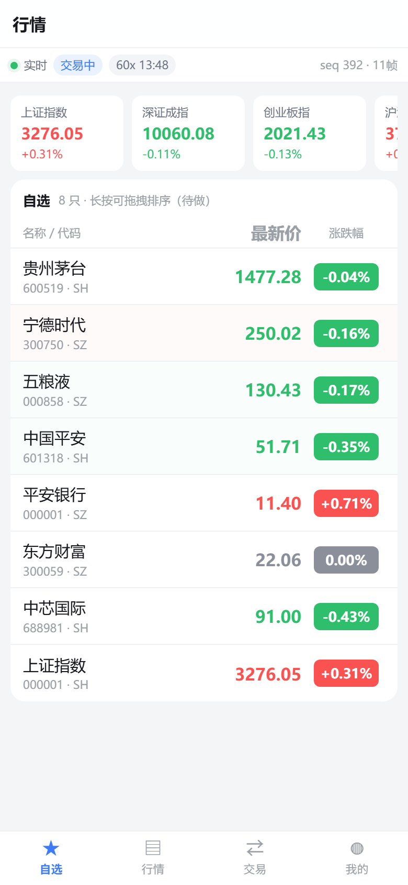
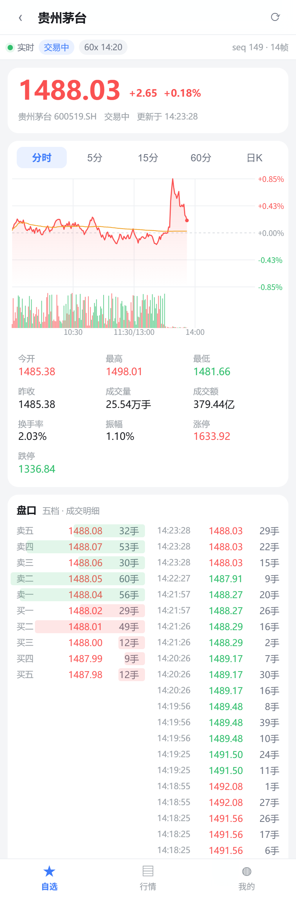
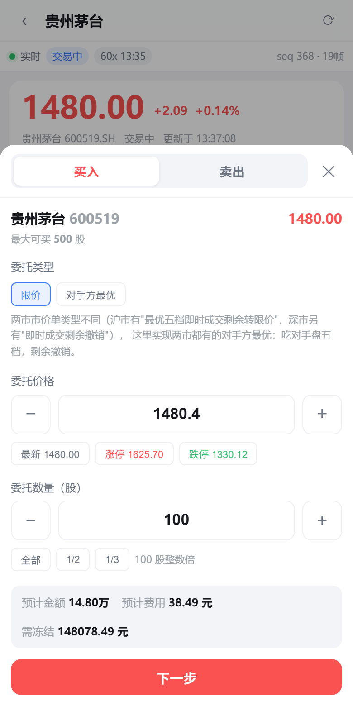
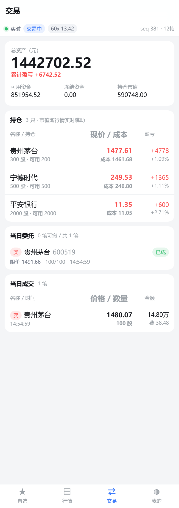

# A股行情移动端 H5


一个**可运行、可演示、可验证**的证券行情前端作品：实时推送 → 自选列表 → 个股详情（分时 / 日K / 五档 / 逐笔）→ 交易状态机。

面向「大前端 + 证券 / 行情 / 交易 / 金融数据」方向的能力证明。**零图表库**，图表全部 Canvas 手写。






---

## 这个项目证明了什么

| 岗位要求 | 本项目的落点 | 可验证的证据 |
|---|---|---|
| 高频数据渲染 | 细粒度订阅 store，单只标的独立重渲染 | React DevTools Highlight updates：只有变化的行在闪 |
| 网络 / 协议 / 稳定性 | WS 广播帧 + 全局 seq + 心跳 + 退避重连 + 缺口补拉全量 | `pnpm test:protocol` 17 项断言全通过 |
| 绘图 / 动画 / 性能 | Canvas 自绘分时图与蜡烛图（均价线、量能、十字光标、DPR 适配） | 曲线终点 246.0px vs 期望 245.7px（像素级校验） |
| 金融数据建模 | 逐笔 → 1 分钟 bar → 日线，读时聚合；涨跌停价 / 换手率 / 振幅 | 快照的 开高低量额 与分时图完全自洽 |
| 业务理解 | 交易状态机、涨跌停规则、封板盘口语义、红涨绿跌、价格笼子校验 | 非交易时段下单按钮自动禁用并给出原因 |
| **交易链路** | 下单 / 撤单 / 委托状态机 / 成交与资金持仓实时回报 / **幂等防重** / **T+1** / 两套冻结（资金·股份） | `pnpm test:trading` **38 项断言**全通过 |
| 加分项：Node 后端 | BFF 代理行情源（浏览器无法直连）、K 线聚合服务、本地撮合与账务 | `/api/*` 全部可用，可切真实行情源 |
| 工程化 | pnpm monorepo、严格 TS、协议自动化自测、无头浏览器视觉验证 | `pnpm -r typecheck` 全绿 |

---

## 快速开始

```bash
pnpm install

# 一条命令同时起 BFF + Web
pnpm dev
#   → BFF  http://localhost:8787
#   → Web  http://localhost:5173
```

打开 <http://localhost:5173> —— **任何时间打开都能看到完整行情**（见下方「虚拟时钟」）。

也可以分开起：

```bash
pnpm dev:server     # 只起 BFF
pnpm dev:web        # 只起前端（Vite 代理 /api 与 /ws 到 8787）
```

---

## 架构

```
┌────────────────────────── 浏览器（移动端 H5）──────────────────────────┐
│  React + TS                                                            │
│                                                                        │
│   QuoteRow ──useQuote(symbol)──┐                                       │
│   IndexCard ─useQuote(symbol)──┤  细粒度订阅：谁变谁重渲染             │
│   DepthPanel ─useQuote(symbol)─┤                                       │
│   TimeShareChart / KLineChart ─┘  Canvas 自绘（无图表库）              │
│   OrderSheet / TradePage ─────→ 交易 store（委托/成交/账户各自订阅）    │
│                                        ▲                               │
│              REST 下单·撤单·查询        │   WebSocket 行情 + 交易私有回报 │
└────────────────────────────────────────┼───────────────────────────────┘
                                         │
┌────────────────────────────────────────┴───────────────────────────────┐
│  BFF / 行情网关（Node + ws）                                            │
│                                                                        │
│   MarketGateway   每 500ms 推进一帧 → 全局 seq++ → 单次序列化 → 广播    │
│        │           交易回报走私有推送（不进 seq，不受订阅过滤）          │
│        │                                                               │
│   QuoteSource ──── MockQuoteSource（随机游走 + 涨跌停 + 封板盘口）      │
│        │           EastmoneyQuoteSource（真实 L1 行情，本地构造五档）    │
│        │                                                               │
│   KlineStore  appendTick → 1m bar（upsert） → 日线（读时聚合）          │
│                                                                        │
│   TradingService  校验(共享函数) → 冻结 → 撮合 → 成交 → 释放           │
│                   幂等表 / T+1 / 两套冻结（资金·股份）                  │
│                                                                        │
│   SimClock    live 真实时间 / replay 虚拟时间（60 倍速，可翻日）        │
└────────────────────────────────────────────────────────────────────────┘
```

---

## 目录结构

```
stock-market-h5/
├─ packages/
│  ├─ market-core/            共享层：模型 / 协议 / 交易时段 / 指标 / 格式化 / **交易规则**
│  │  └─ src/
│  │     ├─ types.ts          Instrument、Quote、Tick、Bar、MarketPhase
│  │     ├─ protocol.ts       帧协议、Codec 接口、SequenceGuard（序号守卫）
│  │     ├─ market-time.ts    交易时段状态机、交易分钟序号
│  │     ├─ indicators.ts     MA / EMA / MACD / KDJ / BOLL
│  │     ├─ trading.ts        Order/Trade/Position 模型、**validateOrder 风控校验**、费用、申报单位、价格笼子
│  │     └─ format.ts         价格精度、手/万手/亿、红涨绿跌、涨跌停价
│  └─ market-client/          WS 客户端：心跳 / 退避重连 / 订阅恢复 / 缺口补拉 / 交易回报路由
├─ apps/
│  ├─ server/                 BFF：行情源 + 网关 + K线聚合 + **交易撮合与账务**
│  │  ├─ src/gateway.ts       广播帧、seq、丢帧注入、订阅并集裁剪、交易私有推送
│  │  ├─ src/kline.ts         交易分钟坐标系、upsert 归并、读时聚合
│  │  ├─ src/trading.ts       账户/持仓/委托/成交、幂等表、撮合、冻结与释放、T+1
│  │  ├─ src/sources.ts       MockQuoteSource / EastmoneyQuoteSource
│  │  ├─ scripts/protocol-test.mjs   行情协议自测（17 项断言）
│  │  └─ scripts/trading-test.mjs    **交易链路自测（38 项断言）**
│  └─ web/                    移动端 H5
│     └─ src/
│        ├─ store.ts          行情细粒度订阅（useSyncExternalStore）
│        ├─ tradingStore.ts   交易 store（委托/成交/账户三套独立订阅）
│        ├─ net.ts            连接接线 + 订阅引用计数
│        ├─ chart/            TimeShareChart / KLineChart / DepthPanel
│        ├─ components/       QuoteRow / ConnectionBar / DebugPanel / **OrderSheet**
│        └─ pages/            自选 / 市场 / **交易** / 详情 / 我的(诊断面板)
└─ tools/
   ├─ visual-check.mjs        零依赖 CDP 工具：量布局溢出 + 设备像素比截图 + 页面求值
   ├─ gh-api-push.mjs         github.com git 通道被重置时的 Git Data API 推送工具
   └─ checks/                 渲染结果断言脚本（颜色一致性 / 图表范围 / K线像素 / **交易全流程**）
```

---

## 四个可深挖的技术点（面试主打）

### 1. 细粒度订阅：行情推模式怎么和 React 共存

行情是「高频、局部变化」的数据：每帧只有几只票在动。常规写法（帧到达 → 顶层 setState）会让整棵组件树每 500ms 重渲染一次。

本项目把订阅粒度**下沉到单个标的**，`QuoteRow` 自己订阅自己那一只，别的票跳动时它连 render 都不会被调度。底层用 `useSyncExternalStore`（React 官方为外部可变数据源开的口子，自带撕裂防护）。

配套细节：`applyQuotes()` 里用 `ts + last + volume` 三字段判等，只有真的变了才通知 —— 这是整个方案的第一道闸门。

> 现场验证：React DevTools → Highlight updates when components render。只有价格真变了的那几行在闪。

### 2. 可靠性：广播帧 + 全局 seq + 缺口补拉

```
服务端                                   客户端
seq++ ─┬─ 发送 ──────────────────────→   accept(seq) 连续 → 正常渲染
       └─ 丢帧（dropRate）─── ✗          accept(seq) 跳跃 → onGap
                                                      → 状态条「缺口补拉中」
                                                      → resync 拉全量快照
                                                      → guard.reset(seq) 恢复
```

三个关键决策：

- **seq 无论是否发出都自增**，所以丢帧必然表现为序号跳跃，客户端不可能"看不出来"。
- **发现缺口不"猜"**：缺数据就是缺数据，直接拉全量快照重建基线。试图按增量补全是错的方向。
- **心跳独立于 onclose**：TCP 可能"假活"（对端进程死了但没发 FIN），只靠 onclose 会一直挂着不重连，必须靠 pong 超时兜底。

> 现场验证：`我的` → 点「注入 40% 丢帧」，观察状态条切到"缺口补拉中"、日志打出缺口区间、1 秒内自动恢复。

### 3. 自绘图表：交易分钟坐标系

分时图最容易踩的坑是**「第几个交易分钟」和「墙上时钟分钟」是两套坐标**：

```
09:30 → 序号 0      11:30 → 序号 119
13:00 → 序号 120    15:00 → 序号 239     ← 午休不占位
```

如果按 `时间戳 = 09:30 + 序号 × 60s` 推算，序号 120 会被算成 11:30，而实时逐笔的墙上时间是 13:00 —— 两套口径对不上，归并（upsert）永远命中不了同一根 bar，分时图就会碎成一堆柱子。（本项目真实踩过，见「踩坑记录」）

其它图表细节：价格轴以昨收为**中轴对称**（上下等幅，避免视觉误读强弱）、右轴显示百分比、均价线、量能柱、DPR 适配、ResizeObserver 重绘。

### 4. 数据链路：逐笔 → 1 分钟 → 日线

- bar 是**归并**不是追加：同一分钟内所有 tick 都 upsert 进同一根，写错就会得到"一分钟几十根 K 线"。
- 粒度转换（1m → 5m/15m/60m）**读时聚合**，写的时候只存 1m。存多份必然产生一致性问题。
- 收盘时把当日分时压成一根日线归档，`commitDay()`。

> 现场验证：详情页切 5分 / 15分 / 60分，看到同一份 1 分钟数据被实时聚合。

### 5. 交易链路：幂等、共享校验、两套冻结

下单这件事故障面最广，三处最容易做错：

**① 幂等键的生成时机 —— 弱网下防重复下单的唯一抓手**

```
用户点"确认" ──→ 生成 clientOrderId ──→ POST /api/orders
                        │
        超时/失败重试 ───┘ 必须复用同一个键
                        ↓
              服务端幂等表命中 → 返回原委托（不重复下单）
```

键绑定在**参数指纹**上：参数不变就复用，参数一改就换新的。
如果每次点确认都新生成一个键，服务端去重完全失效 —— 弱网下必然重复下单。
另外，同一个键换了参数必须**显式报错**（`CLIENT_ORDER_ID_CONFLICT`），而不是静默返回旧单 —— 那是客户端 bug，掩盖它只会让问题更难查。

**② 校验是共享的纯函数 —— 前端只是体验，服务端才是边界**

`validateOrder()` 放在 `market-core`，前端 `onChange` 就调一次做即时提示，服务端收到请求再调一次做最终裁决。
规则只有一份，不会出现"前端说没问题、后端报废单"的漂移。**前端校验可以被绕过，这个认知比实现更重要。**

覆盖的规则：交易时段 / 停牌 / 指数不可交易 / 申报单位（主板创业板 100 股整数倍、科创板 200 股起 1 股递增、北交所 100 股起 1 股递增）/ 涨跌停 / **价格笼子 ±2%**（仅连续竞价生效）/ 可用资金 / 可用持仓。

**③ 两套冻结 + T+1**

| 方向 | 冻结什么 | 成交时 | 终结时 |
|---|---|---|---|
| 买入 | 资金（金额 + 费用） | 按比例释放，差额退回可用 | 释放剩余冻结 |
| 卖出 | 股份（扣 `available`，`volume` 不动） | `volume` 减少、资金到账 | `available` 加回 |

**终结路径必须把剩余冻结释放干净**，漏一处"可用资金"就永久少一块 —— 这是最常见的账务 bug。
`T+1` 则体现在：当日买入只增 `volume` 不增 `available`。

> 现场验证：`pnpm test:trading` 38 项断言；或直接下单看委托状态机推进 + 成交回报推送。

---

| 决策 | 原因 |
|---|---|
| **必须有 BFF** | 行情接口无 CORS 头且校验 Referer，浏览器直连必失败；且行情源降级逻辑应收在服务端，前端只面对一种稳定契约 |
| **广播帧 + 客户端本地过滤** | 单次 `JSON.stringify` 复用给所有连接。按连接逐个序列化会让 CPU 随连接数线性上升 —— 行情网关最典型的性能陷阱 |
| **无订阅不空转** | 没有客户端订阅时直接跳过整帧，不推进行情源、不构造数据、不序列化 |
| **K线走 REST 轮询，行情走 WS** | K线是"大、低频、不需毫秒级一致"的聚合数据；WS 是"小、高频、要低延迟"的快照数据。把 K 线塞进 WS 会让每帧背上几十 KB |
| **symbol 而非 code 做主键** | `000001.SH` 是上证指数，`000001.SZ` 是平安银行 —— 行情系统最经典的坑 |
| **协议与编码解耦** | `Codec` 接口先上 JSON（可读、可抓包），预留二进制实现，压测阶段可直接替换对比 |
| **交易状态由服务端下发** | 前端不用本地时间猜"能不能下单"，否则会出现"服务端说收盘了、按钮还是亮的" |
| **交易回报不进行情帧的 seq** | 行情是"广播 + 可丢 + 可补拉"，交易回报是"用户私有 + 必须逐条送达"。两者共用一根 WebSocket，但可靠性语义不同，混在一起才是错的 |
| **委托与持仓只有一个写入方** | REST 与 WS 都只是 `TradingService` 的出入口。单一写入方 + Node 单线程 = 不需要锁，也不会出现"两个入口各改一半" |
| **最大可买卖放在服务端算** | 整手规则、预留手续费如果前端各算一遍，迟早出现"前端说能买 100 股、后端说资金不足"的错位 |
| **订阅引用计数** | 详情页可能打开不在自选里的票；直接 unsub 会把自选的数据也切断 |

---

## 虚拟时钟：为什么这个 Demo 永远开市

行情 Demo 最大的尴尬是**你演示的时候市场是关着的** —— 晚上、周末打开，页面一片死水。

`SimClock` 有两种模式：

- `live` —— 真实时间，盘中打开就是真实节奏
- `replay` —— 虚拟时间以 N 倍速推进（默认 60 倍：1 真实秒 = 1 虚拟分钟），走到 15:00 自动翻到下一交易日并从起始时刻重新播种

而且服务启动时会把当日分时**从昨收一路播种到当前虚拟时刻**，所以一打开页面就是一张完整的分时图，而不是从空图开始长。翻日时同样会重新播种。

> 结论：任何时间、任何机器打开都能看到完整且"活着"的行情。这对面试现场演示是决定性的。

---

## 环境变量（BFF）

| 变量 | 默认 | 说明 |
|---|---|---|
| `PORT` | `8787` | 监听端口 |
| `SIM_MODE` | `replay` | `replay` 虚拟时间 / `live` 真实时间 |
| `SIM_SPEED` | `60` | 倍速（1 真实秒 = N 虚拟秒）。设 `1` 得到接近真实盘中的节奏 |
| `SIM_START` | `13:30` | 虚拟起始时刻。设 `10:30` 能一进来就看到半天分时图 |
| `FRAME_MS` | `500` | 推帧间隔 |
| `DROP_RATE` | `0` | 人为丢帧概率（演示序号缺口补拉） |
| `QUOTE_SOURCE` | `mock` | `mock` 内置模拟 / `eastmoney` 真实 L1 行情（五档仍为本地构造） |

---

## 验证方式

```bash
# 1. 全量类型检查（4 个包）
pnpm -r typecheck

# 2. 行情协议自动化自测（17 项断言）
pnpm test:protocol
#   [1] 建连握手  [2] 订阅即回快照  [3] 序号连续性
#   [4] 丢包 → 检出缺口 → 自动补拉（核心）  [5] 心跳往返
#   [6] 断线重连 + 订阅恢复  [7] 非法输入防护

# 3. 交易链路自动化自测（38 项断言）
pnpm test:trading
#   [0] 账务自洽（总资产 = 可用+冻结+市值；累计盈亏 = 持仓浮盈合计）
#   [1] 风控前置校验（非整手/超涨跌停/价格笼子/资金不足/持仓不足/未知标的/缺幂等键）
#   [2] 幂等防重（重复提交命中同一笔；同键换参数显式拒绝）
#   [3] 限价买立即成交 · 账务变动 · T+1 可用不变 · 三类回报经 WS 送达
#   [4] 挂单冻结 · 撤单释放 · 重复撤单幂等 · 已成单不可撤
#   [5] 挂单随行情重新撮合成交  [6] 收盘时段下单被拒

# 4. 无头浏览器视觉/渲染校验（需先起服务）
node tools/visual-check.mjs --url http://localhost:4173/ --measure
node tools/visual-check.mjs --url http://localhost:4173/ \
  --eval-file tools/checks/watchlist-consistency.js
node tools/visual-check.mjs --url "http://localhost:4173/#/stock/600519.SH" \
  --eval-file tools/checks/chart-extent.js --out docs/shot-detail.png
node tools/visual-check.mjs --url http://localhost:4173/ \
  --eval-file tools/checks/trading-flow.js    # 23 项交易前端断言
```

`tools/visual-check.mjs` 是零依赖的 CDP 工具（用 Node 内置 WebSocket 直接说协议），能力：
量出**哪些元素溢出了视口**（而不是靠肉眼猜截图）、按设备像素比出图、在页面上下文执行任意表达式核验**渲染结果**。

---

## 附：`git push` 被重置时怎么推送

某些网络下 `api.github.com` 完全正常，但 `github.com:443` 的 git 通道会被重置：
`git push` 报 `Recv failure: Connection was reset`，`git ls-remote` 直接卡死。
此时用仓库自带的 Git Data API 推送工具（只依赖 `api.github.com`）：

```bash
node tools/gh-api-push.mjs              # 推送当前分支到 origin
node tools/gh-api-push.mjs --dry-run    # 只算不上传多少 blob
```

设计取舍（这几条都是踩出来的）：

- **内容以 tree 为准**：建完 tree 后断言远端 tree SHA == 本地 `HEAD^{tree}`，不等就中止且不动 ref。
  这是唯一可靠的一致性强校验 —— commit SHA 会因服务端规范化元数据而变化，tree 不会。
- **SHA 以服务端为准**：commit 的 author/committer/时间戳/消息结尾由服务端生成，
  可能被规范化（实测：时区保留、消息末尾补一个换行）。
  脚本会试几种消息结尾尽量命中与本地相同的 SHA；命中不了就把本地 refs 对齐到服务端提交，
  保证**永远不出现 ahead / 分叉**。
- **复用已有 blob**：先取远端 tree 的 `path → sha` 映射，未变化的文件直接复用，
  不会每次推送都把图片重传一遍。
- **凭据不落盘**：从系统凭据管理器取（`git credential fill`），不打印。
  Windows 上凭据按 `git:https://<user>@github.com` **分账号**存储，
  必须带 username，否则会退化成交互提示而卡死 —— 这是本机实测踩过的坑。
- **空仓库要先播种**：Git Data API 对没有任何提交的仓库会返回
  `409 Git Repository is empty`，所以脚本会先用 Contents API 造一个 README 提交建出分支。
- **拒绝在脏工作区运行**：对齐 refs 时它会执行 `git reset --hard`，会丢弃未提交的改动 ——
  开发这个脚本时它就把自己尚未提交的修复冲掉过一次。现在工作区不干净会直接拒绝运行
  （确需继续用 `--allow-dirty`，那样会跳过本地 refs 对齐）。

---

## 踩坑记录（都是本项目真实修过的）

### 1. 交易分钟 vs 墙上时钟分钟

**现象**：分时图只有 21 根数据，曲线被压在左侧一小条。
**根因**：播种用"第几个交易分钟"连续排布时间戳（忽略午休），实时 tick 用墙上时钟分钟。两套口径对不上 → upsert 永远命中不了同一根 bar → 数据碎且稀疏。
**对策**：统一到 `sessionSlotToEpoch(slot)` 单一坐标系，播种与归并共用。修复后 `barsFromApi` 从 21 → 180，`distinctMinutes === bars.length`。

### 2. 虚拟翻日只清空、不重播种

**现象**：翻日之后分时图变空，看起来像"数据挂了"。
**对策**：给网关加 `onRollover` 回调，翻日后重新播种，并把播种结果回填到快照的开/高/低/量/额。

### 3. `useSyncExternalStore` 必须返回新引用

**现象**：成交明细永远不刷新。
**根因**：`applyTicks()` 里对数组原地 `unshift`，引用没变，React 认为快照没变。
**对策**：改为生成新数组（`[t, ...prev].slice(0, N)`）。**React 的订阅靠引用比较，任何原地修改都是静默失败。**

### 4. 派生字段必须能互相对上

**现象**：分时图显示成交几万手，详情页"成交量"只有几百手。
**根因**：图表用的是播种数据，快照里的量只是"服务启动后累积"的。
**对策**：播种时同步回填快照的累计量额与开高低。**行情产品里所有派生字段互相矛盾，一眼就露馅。**

### 5. 挂单状态永远停在"待报"

**现象**：远离市价的买单下进去后一直显示"待报"，从来没有走到"已报"。
**根因**：`match()` 在"这一轮没成交"时直接 `return`，忘了把状态从 `pending_new` 推进到 `new` —— 状态机有一半路径没走。
**对策**：未成交且仍是 `pending_new` 时推进为 `new` 并抛回报；后续重撮时状态已是 `new`，天然幂等。
**是自动化测试抓出来的** —— 手点页面很难注意到"待报"和"已报"的区别。

### 6. 一进交易页就显示"累计盈亏 +43 万"

**现象**：初始账户总资产 144 万，累计盈亏显示 +43 万。
**根因**：本金基数只取了初始现金 100 万，**底仓成本被整体算成了盈利**（43 万正好等于底仓成本）。
**对策**：本金基数 = 初始现金 + 底仓成本；并把两个不变量写进测试：
`总资产 = 可用 + 冻结 + 持仓市值`、`累计盈亏 = 持仓浮动盈亏合计`。

### 7. 测试偶发失败：挂单等不到成交

**现象**：`挂单随行情重新撮合` 这条用例偶尔失败，重跑又过。
**根因**：测试跑约 90 秒，而 60 倍速下**一个虚拟交易日恰好也是 90 秒** —— 中途翻日会重置价格，挂单自然等不到。
**对策**：测试实例的倍速降到 20（虚拟日约 17 分钟），彻底避开翻日。**这是测试环境问题，不是撮合逻辑问题** —— 区分这两者是排查的基本功。

---

## 路线图

- [x] **M1** 骨架 + BFF + WS 广播帧 + 自选列表
- [x] **M2** 分时图 + 日K（Canvas 自绘）
- [x] **M3** 五档盘口 + 成交明细 + 实时刷新
- [x] **M4** 可靠性：seq 缺口补拉 / 心跳 / 退避重连 / 订阅恢复
- [x] **M5** 交易模块：下单弹层、涨跌停价带出、价格笼子校验、**幂等防重**、委托状态机、委托/成交/资金持仓实时回报、撤单、T+1、两套冻结
- [ ] **M6** 性能基准报告（DOM vs Canvas vs WebGL）、二进制协议 Codec、WebGL 批量绘制
- [ ] **M7** AI Native：自然语言问行情 / AI 解读 K 线 / 用 Agent 生成 UI
- [ ] **M8** 交易增强：市价单细分沪深类型、条件单、算法单、多账户

---

## 已知限制（面试主动说明，别等被问）

1. **五档盘口是本地构造的**：公开 Level-1 接口不保证提供十档 / 逐笔深度（那是 Level-2 付费行情）。所以用的是真实最新价 + 本地构造盘口，且明确标注数据来源，不做"假装有 Level-2"的事。
2. **日线历史是合成数据**：确定性伪随机生成，为了让 K 线一打开就有内容。换真实数据源只需替换 `seedDaily()`，聚合逻辑完全不用动。
3. **撮合在本地模拟**：真实撮合在交易所。这里对着当前盘口撮（限价按对手价、市价吃五档剩余撤销），足以表达下单全链路，但**不是真实报盘**，也没有交易所回报的两阶段异步时序。
4. **无鉴权、无持久化**：账户与委托都在内存里，重启即重置；自选列表写死在后端常量。真实系统需要用户体系、行情权限（Level-2 是付费授权）、以及交易数据的可靠持久化。
5. **K 线轮询间隔 2 秒**：真正常用的做法是"历史走 REST 一次性拉取 + 增量由 WS 推送合并"，这里为控制复杂度先用了轮询。
6. **A 股规则随监管调整**：涨跌停幅度、价格笼子、申报单位等以交易所最新规则文档为准，代码里标注了依据与简化处。
